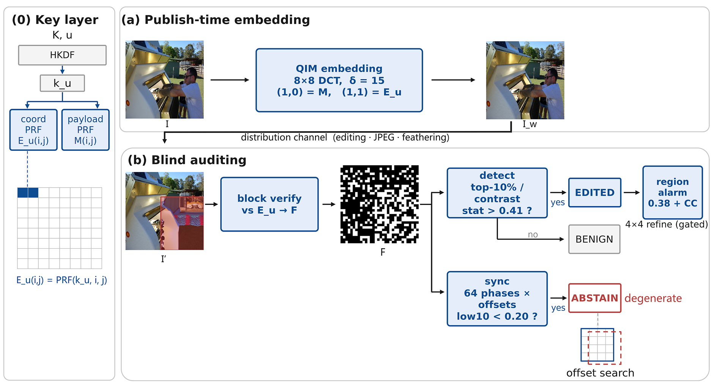

# WMFailDet — Watermark Failure as Evidence (WAFE)



**A training-free forensic baseline that turns watermark *failure maps* into tampering evidence.**

When a fragile watermark is embedded in an image and that image is later locally edited by a
generative model (Stable Diffusion inpainting, InstructPix2Pix, LaMa, ...), the watermark does not
survive. Existing watermarking research treats this as a failure and discards the sample. This
repository takes the opposite view: **where and how the watermark fails is itself evidence of
tampering** — and it can be read out with zero training, zero weights and a single CPU thread.

The key observation: the per-block check-bit failure rate of a clean watermarked image is stable at
20–25 %, while a diffusion edit pushes the failure rate inside the edited region to ~50 %. The gap
between the two distributions is large enough to be crossed **without recovering a single payload
bit**, and the spatial clustering of failed blocks directly gives the edited region.

---

## Method

The framework has three layers (see figure above):

| Layer | What it does |
|---|---|
| **(0) Key layer** | A master key `K` and content ID `u` are expanded through HKDF-SHA256 into a per-image key `k_u`. Two PRFs derive the check-bit sequence `E_u(i,j) = PRF(k_u, i, j)` (coordinate-only, so it survives cropping) and the payload sequence `M(i,j)`. |
| **(a) Publish-time embedding** | QIM embedding writes `M` and `E_u` into the (1,0) / (1,1) low-frequency coefficients of every 8×8 DCT block (`δ = 15`). The watermarked image `I_w` is visually indistinguishable from `I`, and is then distributed through the usual channel (editing, JPEG, feathering). |
| **(b) Blind auditing** | Given only `I'`, `K` and `u`, the auditor recomputes `E_u`, verifies every block, and obtains the failure map `F`. Two decision branches follow: **detect** (top-10 % / contrast statistics → `EDITED` / `BENIGN`) and **sync** (64 pixel phases × block offsets → `ABSTAIN` on degenerate inputs). A connected-component analysis over `F` (threshold 0.38) outputs the **region alarm**, optionally refined on a 4×4 grid. |

Colour code in the figure: **blue** = components of this method, **red** = abstain output and edited
region, **grey** = off-the-shelf components.

Design choices worth noting:

- **Keyed check bits.** A global fixed seed is equivalent to a public key: an attacker can re-embed
  the known pattern and wash the edit away (measured: 96.5 % of tampered images fully laundered).
  Deriving `E_u` from a per-image key drops the wash-out rate to 0 % in all three re-embedding
  variants we tested.
- **Coordinate-only PRF.** Because the check bit depends on `(i, j)` only, arbitrary-pixel-phase
  crops can be re-aligned by search, while resampling/rotation trigger an explicit `ABSTAIN`
  instead of a false alarm.
- **No decoder.** The detector never tries to read the payload. Only *failure* is measured, which is
  why no training is needed.

---

## Results (summary)

| Setting | Value |
|---|---|
| Detection AUC (COCO-256, 1200 images, split-half) | **0.974** (boot 95 % CI 0.968–0.980) |
| TPR at 1 % FPR | 77–80 % |
| Clean-image block failure rate | 20.6–25.0 % across 5 image domains |
| Region-alarm coverage (≥50 % of the edited area), 4×4 layer | **98.8–100 %** |
| Coverage on small edits (<10 % of the image) | 58.7 % (8×8) → **95.7 %** (4×4) |
| Re-embedding wash-out rate, fixed seed → keyed | 96.5 % → **0 %** |
| Cost | 0 weights, CPU, ~8 ms per image |
| Evaluated on | 2199 samples, 5 domains, 3 editors (SD inpainting, IP2P, LaMa) |

### Unified cross-method comparison (same protocol, same metrics, COCO `n`=120)

Because pixel IoU favours mask-supervised localisers, we re-evaluate every baseline under
**our** metric suite on the identical COCO subset (`code/r30_unified_compare.py`):

| Method | Detect AUC | TPR@1% | Region coverage | Area ratio | Out-of-distribution geometry |
|---|---|---|---|---|---|
| WAFE (coord) | 0.961 | 85.0 % | 85.8 % | 1.24 | abstains 65--100 % |
| WAFE (matrix) | 0.958 | 80.0 % | 83.3 % | 1.24 | -- |
| WAM (presence mask) | 0.994 | 100 % | 100 % | 1.07 | no false alarm, no abstain output |
| **WAM (message recovery)** | **0.517** | 3.3 % | 100 % | 1.07 | reports BENIGN |
| EditGuard (recovery mask) | 1.000 | 100 % | 100 % | 1.15 | **flags the whole image as tampered (7/7 conditions)** |
| TrustMark (secret + sliding window) | 0.758 | 51.7 % | 100 % | **8.23** | -- |
| Fixed-seed QIM (no key) | 0.970 | 70.8 % | 82.5 % | 1.22 | -- |
| LSB fragile watermark | 1.000 | 100 % | 45.0 % | 0.44 | AUC 0.49 after JPEG 85 |

Three readings, all reported as-is:

1. **Training-based methods genuinely win on coverage** -- that is what mask supervision buys, and we do not dispute it.
2. **A watermark trained to *recover a message* cannot act as an edit detector**: WAM's bit-accuracy
   score gives AUC 0.517 on COCO and exactly 0.500 on four further domains (its post-edit bit accuracy
   stays ~100 %, indistinguishable from clean). "Alive" is not "judgeable".
3. **Coverage must be read together with area ratio**: TrustMark's 128 px window alarm also scores 100 %
   coverage, but its area ratio is 8.23 (256 px fits only 2x2 windows, so one alarm box ≈ the whole image).
   Reporting coverage alone rewards over-circumscribing -- hence our three-metric protocol.

Out-of-distribution geometry sweep (`code/r30_geo_sweep.py`, 7 conditions, `n`=60): EditGuard marks
clean watermarked images as fully tampered in **all 7** conditions (mask area ratio 0.9999--1.0 vs 0.0002
undistorted); WAM does not false-alarm but has no way to declare an input undecidable. WAFE abstains
(65--92 % on scale round-trips at the 8x8 layer, 100 % on rotation; false-abstain rate 1.7 % on clean images).

Pixel-level IoU of the training-free baseline (0.74–0.82 with the 4×4 layer) is lower than
training-based localisers (WAM 0.91–0.97, EditGuard 0.90–0.97); region-level alarms are the intended
output of this method, and pixel-level contours can be refined by stacking a trained localiser on
top of the alarm region.

---

## Repository layout

```
code/
  keyed_scheme.py          # core: HKDF keying, coordinate PRF, QIM embed, fail map, statistics
  r7_keyed_scheme.py       # keyed scheme evaluation protocol (crop/paste, synthetic edits)
  r1..r29_*.py             # experiment scripts (delta sweep, geometry, domains, editors,
                           #   region alarm, resolution, security/wash-out, baselines, ...)
  r30_unified_compare.py   # cross-method comparison under one metric suite (WAM / EditGuard /
                           #   TrustMark / fixed-seed QIM / LSB), COCO + 4 extra domains
  r30_geo_sweep.py         # out-of-distribution geometry sweep (7 conditions x 3 methods)
results/                   # JSON outputs, incl. r30_unified_compare_<domain>.json and r30_geo_sweep.json
assets/framework.jpg       # method figure
```

## Requirements

```
python >= 3.9
numpy
opencv-python
pillow
```

The comparison scripts additionally use `torch` + `diffusers` (for WAM / EditGuard baselines) and
are only needed to reproduce the comparison tables.

## Quick start

```python
import numpy as np
from PIL import Image
import keyed_scheme as ks

master = ks.new_master_key()               # 32-byte master key, kept offline
uid    = "coco:1167"                       # public content ID

img = np.array(Image.open("host.png").convert("RGB"))

# --- publish side -------------------------------------------------
k_u    = ks.image_key(master, uid)         # per-image key
img_w  = ks.embed_keyed(img, k_u, delta=15, pay=(1, 0), chk=(1, 1), pattern="coord")

# --- audit side (blind: no original image, no payload) ------------
fail = ks.fail_map(img_w, k_u, delta=15)   # per-block failure map F (1 = failed)
rate = ks.check_fail_rate(img_w, k_u)      # clean images: ~0.20–0.25

fail_s = ks.smooth_fail_map(fail, 9)       # aggregation used by the statistics
```

The detection statistics (`top-10 %` mean failure and spatial `contrast`), the threshold calibration
(split-half) and the region-alarm connected-component step are implemented in
`code/r18_region_alarm.py` and `code/keyed_scheme.py`.

## Data

No images are shipped with this repository. The evaluation protocol uses:

- COCO 2017 images, 256×256, locally edited with Stable Diffusion inpainting (Chinese instructions + bbox paste-back);
- 640×480 images edited with InstructPix2Pix;
- cross-domain sets: butterflies, EuroSAT, FUNSD documents, Pokémon, cartoons;
- LaMa (non-diffusion) edits for editor-agnosticism.

Any host image works as long as the auditor holds the same master key and the content ID.

### Paths

Each experiment script reads its datasets from module-level constants at the top of the file
(`AS` for the COCO attack set, `XD`/`HIRES` for the cross-domain and high-resolution sets,
`REPO`/`EG` for the vendored WAM and EditGuard checkouts). Point them at your own copies before
running; `results/` is written automatically.

## Notes

- The QIM step size `δ = 15` is the default; the localisation accuracy is largely independent of
  `δ` (0.572–0.586 IoU for `δ ∈ {8, 15, 25, 40}`), while `δ` controls the clean-image noise floor
  (PSNR 48.9 → 41.3 dB).
- Small edits (brightness <10 %, noise σ ≤ 2) fall below the sensitivity floor; blur/sharpen
  perturbations raise the contrast statistic and should be reviewed by a human.
- The contrast statistic is less transferable across domains than the top-10 % statistic;
  cross-domain deployment should use top-10 % as the primary criterion.
