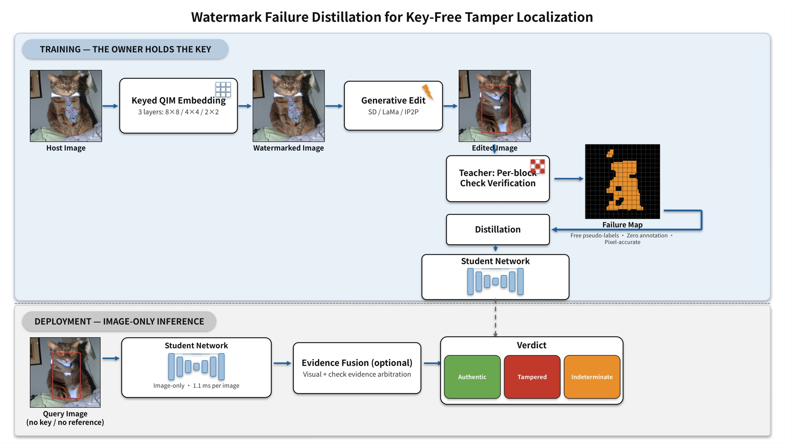

# Watermark Failure as Free Supervision

**A zero-annotation framework that turns watermark failure maps into a key-free tamper localizer.**



When a fragile watermark is embedded in an image and that image is later locally edited by a
generative model (Stable Diffusion inpainting, InstructPix2Pix, LaMa, ...), the watermark does not
survive the edit. Existing watermarking research treats this as a failure to be prevented. This
repository takes the opposite view: **where the watermark fails is itself a pixel-accurate label**,
and it can be collected at zero annotation cost by anyone who owns the unedited original.

The resulting detector runs on the image alone — no watermark, no key, no reference — which is the
deployment shape a platform auditor actually has.


## The task: KeyFree-Loc

| Phase | What is available |
|---|---|
| Training | master key, unedited images, unlimited pair generation |
| Inference | the query image only — no key, no watermark embedder, no teacher |

Active watermarking localizers (EditGuard, OmniGuard, WAM) all need reference-side information at
inference, so they cannot run under this setting. Passive forensic detectors run on the image but
need manual pixel masks to train. KeyFree-Loc removes both requirements.

## Method

1. **Teacher (zero training).** Keyed QIM embedding in three layers (8×8 / 4×4 / 2×2). After an
   edit, per-block check bits fail exactly inside the edited region: the failure rate saturates at
   1/2 inside and stays at the clean baseline (~0.25) outside. The 2×2 layer yields pixel-level
   labels.
2. **Free pseudo-labels.** The failure map is binarised into a training mask — no human
   annotation, roughly 0.2 s per image.
3. **Student (1.93 M params).** A standard U-Net (four encoder stages, three decoder stages,
   skip connections) distilled from those labels. It never sees a watermark; it learns the local
   consistency break that the edit leaves behind. 1.1 ms per image on GPU.
4. **Evidence fusion (optional).** When the auditor does hold the key, visual evidence and check
   evidence are arbitrated into a three-way verdict (authentic / tampered / abstain).

The embedding strength δ is chosen by a noise-versus-sharpness search rather than fixed by hand.
It moves the main result from 0.9335 to **0.9491 ± 0.0012** (three seeds, 2000 training images,
400 test images).

## Results at a glance

| Method | IoU | Needs at inference |
|---|---|---|
| Teacher, 4×4 layer | 0.726 | watermark + key |
| **Student (ours)** | **0.9491 ± 0.0012** | **image only** |
| EditGuard, same protocol and test set | 0.9272 | reference watermark |
| Student supervised with manual GT masks | 0.903 | image only |

Free labels beat manual GT masks on the same architecture, and the key-free student also beats the
same-protocol reference-watermark baseline. Evaluation covers five tracks (same-domain,
cross-domain, cross-editor, degradation, verdict) over roughly 6.2k edited samples; the per-run JSON
outputs quoted in the paper live under `results/`.

## Repository layout

```
code/               experiment and evaluation scripts (r*.py, numbered by experiment)
figures_scripts/    scripts that render every figure
figs/               rendered figures (PDF/PNG)
results/            per-experiment JSON outputs
assets/             images used by this README
```

## Reproducing the main result

```bash
# 1) watermarked + edited pairs with free failure-map labels
python code/r61_L2_scale.py

# 2) embedding-strength search (delta = 8 / 15 / 25)
python code/r70_delta_search.py

# 3) three-seed confirmation of the chosen configuration
python code/r72_delta25_seeds.py

# 4) five-track evaluation of the final student
python code/r73_delta25_full.py
python code/r73b_tracks25.py
```

Each script writes a JSON file under `results/` whose values match the reported tables.

## Boundary of the method

- The watermark scheme is interchangeable: any scheme that a local edit can break can serve as the
  teacher, which keeps the method decoupled from a specific embedder.
- The labels assume *local* edits. Global instruction editing rewrites the whole frame and removes
  the retained-region reference; the student then collapses (IoU 0.253 on InstructPix2Pix). Heavy
  resampling (JPEG ≤ 75, resize, rotate, feather) also destroys the 2×2 signal — the system flags
  those cases as abstain rather than returning a wrong region.

## Licence

Research code, provided as is for academic use.
