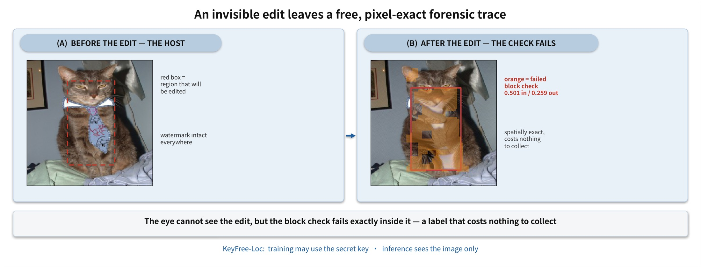

# FreeMark — Watermark Failure Is Free Pixel-Level Supervision

**Zero-label, key-free image manipulation localization against generative edits.**

A watermark that fails under a generative edit is not a loss to be prevented — it is a
pixel-accurate label that costs nothing to collect.


A fragile (keyed QIM) watermark is embedded before publication. When the image is later locally
edited by a generative model (Stable Diffusion inpainting, InstructPix2Pix, LaMa, ...), the
watermark does not survive inside the edited region: per-block check bits fail there at chance
level (≈1/2) while staying at the clean baseline (≈1/4) elsewhere. That failure map is therefore a
**free, pixel-level, edit-aligned training signal** — and the detector distilled from it runs on the
image alone: no watermark, no key, no reference image.



## The KeyFree-Loc setting

| Phase | Available |
|---|---|
| Training (publisher) | master key, unedited images, unlimited pair generation |
| Inference (auditor) | the query image only — no key, no watermark embedder, no teacher |

Active watermarking localizers (EditGuard, OmniGuard, WAM) need reference-side information at
inference, so they cannot run in this setting; passive detectors run on the image but need manual
pixel masks to train. KeyFree-Loc removes both requirements.

## Method

1. **Teacher (zero training).** Keyed QIM embedding in three layers (8×8 / 4×4 / 2×2) on DCT
   coefficients; the per-block check bits come from a per-image key. After an edit, checks fail
   inside the edited region and nowhere else, producing a failure map at ~8 ms/image on CPU.
2. **Free pseudo-labels.** The smoothed failure map is thresholded into a training mask — no human
   annotation, no learned teacher.
3. **Student (1.93 M parameters).** A compact U-Net distilled from those masks. It never sees a
   watermark; it learns the local consistency break left by the edit. 1.1 ms/image on GPU,
   35.7 ms/image on CPU.
4. **Evidence-chain fusion (optional).** When the auditor does hold the key, visual evidence and
   check evidence are arbitrated into a three-way verdict (authentic / tampered / indeterminate).

The embedding step δ is set by a noise-versus-sharpness search (δ ∈ {8, 15, 25}) rather than fixed
by hand; the chosen configuration is δ = 25.

## Results at a glance

Same-domain test split (400 images, δ = 25, three seeds):

| Method | IoU | Needs at inference |
|---|---|---|
| Teacher, 8×8 layer | 0.591 | watermark + key |
| Teacher, 4×4 layer | 0.726 | watermark + key |
| **Student (ours)** | **0.9491 ± 0.0012** | **image only** |
| EditGuard (same protocol / test set) | 0.9272 | reference watermark |
| Student supervised with manual GT masks | 0.9872 | image only |
| Noiseprint++ (unsupervised passive) | 0.001 | image only |

Free labels reach 96 % of the manual-mask upper bound; the key-free student also beats the
same-protocol reference-watermark baseline. Supervision-source ablation (same architecture,
δ = 25): free failure-map labels 0.9491, noisy human-grade boxes 0.6884, image-level 0.2943,
point-level 0.0009. Evaluation spans five tracks — same-domain, cross-domain, cross-editor,
degradation, forensic verdict — over ~6.2 k edited samples.

## Quick start

```bash
python -m pip install -r requirements.txt        # Python 3.10+
```

Fetch the data (see below), then run the pipeline in order:

```bash
# 1) build watermarked + edited pairs with free failure-map labels (T1)
python code/r53_build_bigset.py

# 2) embedding-strength search (delta = 8 / 15 / 25)
python code/r70_delta_search.py

# 3) three-seed confirmation of the chosen configuration
python code/r72_delta25_seeds.py

# 4) five-track evaluation of the final student
python code/r73_delta25_full.py
python code/r73b_tracks25.py

# 5) ablations and extras
python code/r74_gt_upper_d25.py       # manual-GT upper bound
python code/r76_label_ablation_d25.py # supervision-source ablation
python code/r75_forensic_d25.py       # forensic cost / verdicts
python code/r77_noiseprint_baseline.py
python code/r78_qual_compare.py       # qualitative panels
```

Every script writes a JSON file under `results/`; the numbers in the tables above are read from
those files (`results/r7x_*.json`).

## Dataset

Two ways to get the data.

**(a) Download the packaged benchmark** (recommended). The archives are attached to the
[Releases page](https://github.com/vron8632/WMFailDet/releases/tag/v1.0-keyfree-bench) (≈1.3 GB in
total; mirrored copies on a domestic file host are welcome — please keep the archive names):

| Archive | Content |
|---|---|
| `KeyFree-Bench-T1-samedomain.zip` | 4,000 originals + 4,000 edited images + masks + `meta.json` |
| `KeyFree-Bench-T2-crossdomain.zip` | Butterflies / EuroSAT / FUNSD / Pokémon edits |
| `KeyFree-Bench-T3-crosseditor.zip` | LaMa edits + the high-resolution InstructPix2Pix set |
| `weights-r73-delta25.zip` | the distilled student (`r73_delta25_student.pth`, 7.7 MB) |

Unzip into `data/` so that the paths match the scripts, e.g. `data/bigset/images/orig_b00000.png`.
*Note:* to keep the archives small, image files are JPEG (quality 95) encoded while keeping their
`.png` names — PIL and OpenCV decode them transparently. Masks are stored losslessly.

**(b) Rebuild from public sources** (bit-exact):

- T1: COCO 2017 `val2017` → `code/r53_build_bigset.py` (SD 1.5 inpainting, bbox-restricted edits)
- T2: HuggingFace `huggan/smithsonian_butterflies_subset`, `huggan/pokemon`, EuroSAT, FUNSD →
  `code/r16_xdomain_gen.py`, `code/r23_domain_edits.py`
- T3: LaMa edits `code/r25_lama_edits.py`; high-resolution InstructPix2Pix `code/r21_hires_expand.py`
- Watermarking, failure maps and distillation: `code/keyed_scheme.py`, `code/r7_keyed_scheme.py`,
  `code/r14b_multiscale.py`, `code/r34_distill_matrix.py`

Expected layout:

```
data/
  bigset/            images/{orig,att,mask}_<id>.png, meta.json     # T1
  xdomain/           images/, butterfly_edits/, sat_edits/, doc_edits/,
                     pokemon_edits/, lama_edits/                    # T2 / T3
  hires_expanded/    images/, meta.json                             # T3 high-resolution
```

## Repository layout

```
code/               experiment and evaluation scripts (r*.py, numbered by experiment)
results/            per-experiment JSON outputs
assets/             images used by this README
tools/              dataset packaging helper
```

## Scope and limits

- The watermark scheme is interchangeable: any scheme a local edit can break can serve as the
  teacher, which keeps the method decoupled from a specific embedder.
- The labels assume *local* edits. Global instruction editing rewrites the whole frame and removes
  the retained-region reference; the student then collapses (IoU 0.253 on InstructPix2Pix). Heavy
  resampling (JPEG ≤ 75, resize, rotate, feather) also destroys the 2×2 signal — the system flags
  those cases as indeterminate rather than returning a wrong region.
- The teacher needs a keyed watermark embedded before publication; images that were never
  watermarked cannot be handled.

## License

Released under the [MIT License](LICENSE) — free to use, modify, and redistribute, including for
commercial purposes, provided the copyright notice is retained.
